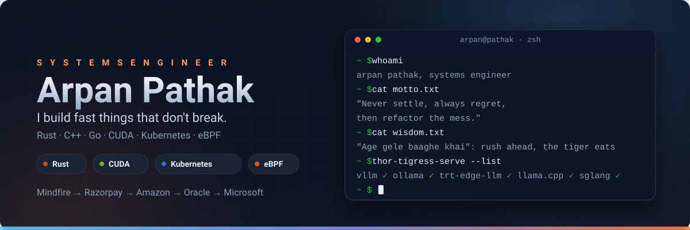

  

  <b>Systems Software Engineer</b> · Mindfire Solutions → Razorpay → Amazon → Oracle → Microsoft 
  Rust · C++ · Go · CUDA · Kubernetes · eBPF

  <i>"Never settle, always regret, then refactor the mess."</i> 
  <i>"Age gele baaghe khai"</i> (আগে গেলে বাঘে খায়): rush ahead, and the tiger eats you.

  <b>🛠 Languages</b> 
  
  
  
  
  
  
  
  

  <b>⚙️ Systems · Edge AI · Cloud</b> 
  
  
  
  
  
  
  
  

  
  
  
  

---

## ⚡ Flagships

### 🐯 Thor Thunder Tigress Platform: edge GPU cluster, data curation, multi-engine serving

  

  
  
  
  
  

> **Full-stack hardware and software platform** to build a distributed edge GPU cluster, curate data to fine-tune LLMs, and serve them through a multi-engine inference layer: **vLLM, Ollama, TensorRT Edge LLM, llama.cpp, SGLang**.
>
> **Data curation.** 13,114 training examples (6.5M tokens, 35 sources), checked by `spark` against slop and the five Rust rules, with before/after scoring for the fine-tune.
>
> **Secured hosting, bring your own domain.** One encrypted key per person. A launch note states what is stored and what is not. voltforge.tech forwards to the cluster over Tailscale.
>
> **OpenAI-compatible model routing that every harness plugs into**: Claude Code, openBatarangs, OpenCode, all on one API. The 30+ chapter book covers the cluster, the checker, the data pipeline, serving, security and keyring crypto.

  
  
  
  
  

### 📖 The Books

  

**⚡ [GPU Parallel Programming from First Principles](https://arpanpathak.github.io/gpu-parallel-book/)**

16 chapters from the mathematics of parallelism to real kernels: Amdahl, Gustafson, the roofline model, warps, streaming multiprocessors, the memory hierarchy. CUDA C++ kernels and the same kernels in Rust with cuda-oxide. Reduction, scan, histogram, tiled matmul, an image-processing capstone, profiling with Nsight Compute. Every program run on a Jetson AGX Thor (sm_110) and Orin NX (sm_87).

  
  
  

**📚 [Cracking the Systems Programming Interview](https://arpanpathak.github.io/cracking-the-systems-programming-interview/)**: books and labs in one repo

- **[Distributed Systems from the Ground Up](https://arpanpathak.github.io/cracking-the-systems-programming-interview/distributed-systems-from-the-ground-up/)**: 28 chapters. Part 1 builds a replicated, sharded key-value store in Rust: write-ahead log, leader replication, Raft election, group commit, each measured against the failures it claims to survive. Part 2: 22 system designs with runnable simulations.
- **[Democratizing Linux: A Pipe Dream](https://arpanpathak.github.io/cracking-the-systems-programming-interview/democratizing-linux/)**: 13 chapters that rebuild kernel mechanisms in user space, every program in Go and Rust: pipes, file descriptors, a shell, signals, CPU scheduling, virtual memory, epoll, TCP, namespaces, cgroups, a container.
- **[GPU-Accelerated Kubernetes](https://arpanpathak.github.io/cracking-the-systems-programming-interview/gpu-accelerated-kubernetes/)**: informers from scratch, a GPU job controller on controller-runtime and kube-rs, how GPUs are shared (time-slicing, MPS, MIG, vGPU, DRA), and a kind cluster whose pods use a real GPU. Go and Rust.
- **[The interview book](https://arpanpathak.github.io/cracking-the-systems-programming-interview/book/)**: 19 chapters in six parts: tools, whiteboard algorithms, memory and the machine, concurrency, the network, interview day.
- **Labs**: 31 Rust modules and 22 programs (hand-rolled async runtime, epoll server, TCP and HTTP servers) with benchmarks and an 8-page report, a Kubebuilder `GpuWorkload` operator, 14 study guides.

  
  

### 🦇 openBatarangs

  

  
  
  
  

> **Agentic coding CLI for local models**: auto-discovers the best Ollama / TensorRT / llama.cpp model on Jetson and edge hardware, then reads, edits, and verifies code with tools. No cloud, no manual model ops.

### 🚗 Driving CivicSense: shipped

  
  

> Edge-AI road safety, **100% on-device**: YOLOv8/v11 → TensorRT (~12 ms) on Jetson Orin, kinematic decision engine, Kalman + Deep SORT, voice alerts, zero video leaves the car. [vision model](https://github.com/arpanpathak/driving-civicsense-vision-model) · [pi-stream](https://github.com/arpanpathak/civicsense-pi-stream) · [stream-client](https://github.com/arpanpathak/civicsense-stream-client) · [companion](https://github.com/arpanpathak/civicsense-companion) · [data-crowd](https://github.com/arpanpathak/driving-civic-sense-data-crowd)

### 📚 More books on the shelf

[🕸️ eBPF from the Ground Up](https://github.com/arpanpathak/ebpf-rust-networking-book) · [📘 Modern C++ Memory-Safe Systems](https://github.com/arpanpathak/modern-cpp-systems-book) · [👁️ Seeing Machines](https://github.com/arpanpathak/seeing-machines-book) · [🎮 Bevy Physics](https://github.com/arpanpathak/bevy-physics-book) · [☸️ Kubernetes Operator Pattern](https://github.com/arpanpathak/kubernetes-operator-pattern) · [🥊 Coding Interview FightClub](https://github.com/arpanpathak/CodingInterviewFightClub_Hustle_600)

---

## 🚀 Featured Projects

<table>
  <tr>
    <td align="center" width="33%">
      <b>🦇 <a href="https://github.com/arpanpathak/openbatrangs">openBatarangs</a></b> 
      Rust · local agentic coding CLI
    </td>
    <td align="center" width="33%">
      <b>🐯 <a href="https://github.com/arpanpathak/thor-thunder-tigress-platform">thor-thunder-tigress</a></b> 
      Rust · edge GPU cluster · multi-engine serving
    </td>
    <td align="center" width="33%">
      <b>⚡ <a href="https://github.com/arpanpathak/gpu-parallel-book">gpu-parallel-book</a></b> 
      CUDA · Rust · 16-chapter book 
      
    </td>
  </tr>
  <tr>
    <td align="center">
      <b>📚 <a href="https://github.com/arpanpathak/cracking-the-systems-programming-interview">cracking-systems-interview</a></b> 
      Books &amp; labs · distributed · Linux · K8s
    </td>
    <td align="center">
      <b>🚗 <a href="https://github.com/arpanpathak/driving-civicsense-vision-model">civicsense-vision-model</a></b> 
      Rust · on-device AI perception 
      
    </td>
    <td align="center">
      <b>🦀 <a href="https://github.com/arpanpathak/cuda-oxide-demo">cuda-oxide-demo</a></b> 
      Rust · CUDA-Oxide · Jetson benchmarks
    </td>
  </tr>
  <tr>
    <td align="center">
      <b>🕸️ <a href="https://github.com/arpanpathak/ebpf-rust-networking-book">ebpf-rust-networking-book</a></b> 
      Rust · eBPF/Cilium/K8s book
    </td>
    <td align="center">
      <b>📘 <a href="https://github.com/arpanpathak/modern-cpp-systems-book">modern-cpp-systems-book</a></b> 
      C++ · memory-safe systems book
    </td>
    <td align="center">
      <b>👁️ <a href="https://github.com/arpanpathak/seeing-machines-book">seeing-machines-book</a></b> 
      Python → Rust · CV book
    </td>
  </tr>
  <tr>
    <td align="center">
      <b>🎮 <a href="https://github.com/arpanpathak/bevy-physics-book">bevy-physics-book</a></b> 
      Rust · physics in Bevy
    </td>
    <td align="center">
      <b>🔍 <a href="https://github.com/arpanpathak/systems-programming-design-patterns">systems-patterns</a></b> 
      Go · systems hands-on 
      
    </td>
    <td align="center">
      <b>🧠 <a href="https://github.com/arpanpathak/AdvancedAlgorithmPatterns">AdvancedAlgoPatterns</a></b> 
      Kotlin · DSA patterns 
      
    </td>
  </tr>
  <tr>
    <td align="center">
      <b>🥊 <a href="https://github.com/arpanpathak/CodingInterviewFightClub_Hustle_600">FightClub_600</a></b> 
      Interview prep · 5 languages 
      
    </td>
    <td align="center">
      <b>📡 <a href="https://github.com/arpanpathak/jobsense-parker">jobsense-parker</a></b> 
      Rust · job-hunt CLI 
      
    </td>
    <td align="center">
      <b>🎸 <a href="https://github.com/arpanpathak/grungeGPT">grungeGPT</a></b> 
      Rust · from-scratch GPT + BPE
    </td>
  </tr>
</table>

> …plus 50+ more repos: [kube-goAt](https://github.com/arpanpathak/kube-goAt), [zero-trust-networking](https://github.com/arpanpathak/zero-trust-networking-examples), [andross](https://github.com/arpanpathak/andross), [multicloud-distiller](https://github.com/arpanpathak/deepseekcoder-multicloud-distiller), distributed systems, ML notebooks, music &amp; audio, websocket scaling, NFC + e-ink hardware, and a Neovim agentic IDE.

---

### 🧰 The Stack

| Layer | Weapons of choice |
|---|---|
| **Languages** | Rust, C++, Go, Kotlin, Python, Java, TypeScript, C |
| **Systems** | Lock-free data structures, memory safety, kernel/eBPF, low-latency |
| **Networking** | TCP/IP, UDP, TLS/mTLS, HTTP/2/3, gRPC, QUIC, Cilium, XDP |
| **Distributed** | Kafka, Flink, Spark, consensus/replication/sharding, CDC |
| **ML/AI** | PyTorch, TensorFlow, BERT, ONNX Runtime, Ollama, edge inference, CUDA |
| **Cloud** | AWS, GCP, Azure, Kubernetes (EKS/AKS), Terraform, Kubebuilder |

---

### 💼 Engineering Experience

| Company | Role | Impact |
|---|---|---|
| **Microsoft** | Software Developer II | Led legacy C++/C# → Rust migration: **40% lower P99, 2× throughput, 3× less memory, 6-figure savings**. Built AI policy engine + zero-trust sovereign networking (eBPF/Cilium). |
| **Oracle Cloud** | Senior Software Engineer | Lock-free DB internals: **+45,000 ops/s**. Terraform provider for Autonomous DB (~$1.2M/mo savings). |
| **Amazon** | SDE II | Real-time ML ranking (XGBoost + DL): **100ms latency, 5% CTR lift, $5.4M/mo revenue**. BERT inference @ **5,000 QPS**. Petabyte-scale data platform. |
| **Razorpay** | SDE | Go UPI gateway: **1M+ hourly transactions, 99.99% uptime**. |

**📄 [Download my resume](RESUME.pdf)**

---

### 🌐 Connect

[**LinkedIn**](https://www.linkedin.com/in/arpan-pathak-272341424/) · [**YouTube**](https://www.youtube.com/@ArpanPathak) · [**GitHub**](https://github.com/arpanpathak) · [**Portfolio**](https://arpanpathak.github.io/) · 📧 arpan.pathak47@gmail.com

---

*Currently: teaching the Thor Tigress Cub on a Jetson AGX Thor to stop writing AI slop, shipping openBatarangs, and writing books that teach it all from first principles.*
